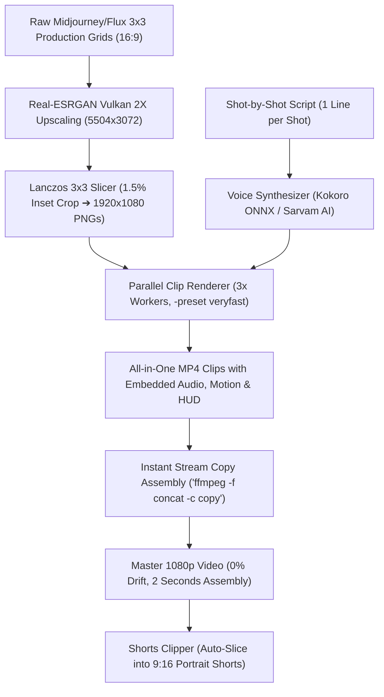

# 🎬 Stickman Cinema

> **Autonomous 2D Stickman Video Generation & Pipeline Engine**  
> An industrial-grade toolchain for building high-retention, YouTube-optimized 1080p anime stickman survival epics with 0% audio-visual drift, 5x parallel rendering, cinematic 2.5D camera motion, Soundza SFX integration, Sarvam AI Hindi voiceovers, and a 9:16 Portrait Shorts & Reels clipper.

[](https://python.org)
[](https://ffmpeg.org)
[](https://github.com/hexgrad/kokoro)
[](https://sarvam.ai)
[](https://soundza.com)
[](https://github.com/xinntao/Real-ESRGAN)
[](LICENSE)

---

## 🌟 Key Features

* **⚡ 5x Real-Time Parallel Rendering**: Bakes audio, dynamic HUDs, 1-line subtitles, and 2.5D camera motion directly into individual shots using `ThreadPoolExecutor` and `-preset veryfast` (encoding 126 shots in ~90 seconds).
* **🎙️ Zero Temporal Drift Architecture**: Direct shot-by-shot narration embedding (`adelay=200|200,apad`) and duration locking (`max(3.0, min(dur+0.25, 4.8))`). Assembled into the final master in **2 seconds flat** via `ffmpeg -f concat -c copy` without re-encoding.
* **🗣️ Multi-Language Voiceover Support**:
  * **English**: Local in-memory **Kokoro ONNX** (`am_liam` @ 0.98 speed) for crisp YouTube explainer pacing.
  * **Hindi**: Cloud integration with **Sarvam AI** (`bulbul:v3`) for localized survival channels.
* **🔊 Soundza SFX Studio Integration**: Search, stream, and download studio-grade sound effects (whooshes, metallic impacts, bunker alarms, monster roars, and explosions) directly through the Soundza API.
* **📱 9:16 Portrait Shorts & Reels Clipper**: Transforms 16:9 widescreen master videos into vertical shorts (1080x1920) with blurred ambient background, series header, part badge, and animated progress bar. Supports auto-chunking an entire episode into sequential ~50s parts.
* **🎥 2.5D Kinetic Camera Engine**: Silky smooth slides (horizontal dolly pans) and slow zooms by default, with **selective seismic impact shakiness** strictly reserved for explosions, shockwaves, and breach beats.
* **🕹️ Dynamic HUD & Gold Achievement System**: Top-left Day/Time pill box (frame-accurate to spoken text), top-right Resource/Threat monitor, and timed gold achievement popups (`between(t, 0.6, 3.6)`).
* **🔪 Lanczos 3x3 Grid Slicer**: Automatically crops 1.5% border margins to strip black dividing borders and resamples cells to crisp 1920x1080 16:9 panels using Lanczos filtering.

---

## 🏗️ Architecture & Pipeline



---

## 🚀 Installation & Setup

### 1. Clone the Repository
```bash
git clone https://github.com/Kartik-gitClient/Stickman-Cinema.git
cd Stickman-Cinema
```

### 2. Install Dependencies
```bash
pip install -r requirements.txt
pip install -e .
```

### 3. Configure Environment Variables
Copy `.env.example` to `.env` and insert your API keys:
```bash
cp .env.example .env
```
In `.env`:
```ini
# Sarvam AI API Key (for Hindi Voiceovers)
SARVAM_API_KEY=your_sarvam_key_here

# Soundza API Key (for Sound Effects & SFX)
SOUNDZA_API_KEY=your_soundza_key_here
```

### 4. System Requirements
* **FFmpeg**: Must be installed and accessible in your system `PATH` (`ffmpeg` and `ffprobe`).
* **Real-ESRGAN Vulkan** (Optional for upscaling): Download portable executable from [Real-ESRGAN Releases](https://github.com/xinntao/Real-ESRGAN/releases) into `tools/realesrgan/`.
* **Kokoro ONNX Models**: Placed in `~/.cache/hyperframes/tts/models/` (`kokoro-v1.0.onnx`, `voices-v1.0.bin`).

---

## 💻 CLI Usage

The tool provides a unified command line interface (`stickman-cinema`):

### 1. Slice a 3x3 Production Grid
Extracts 9 standalone 1920x1080 panels with border margin removal:
```bash
stickman-cinema slice \
  --grid ./assets/grid01_2x.jpg \
  --out ./output/panels \
  --start-index 1 \
  --margin 0.015
```

### 2. Synthesize English Voiceover & Subtitles (Kokoro)
Generates per-shot WAV audio clamped between 3.0s and 4.8s, plus single-line `.ass` subtitles:
```bash
stickman-cinema voice \
  --lines-file ./script.txt \
  --out ./output/audio \
  --sub ./output/subtitles.ass \
  --voice am_liam \
  --speed 0.98
```

### 3. Synthesize Hindi Voiceover (Sarvam AI)
Synthesizes Hindi narration sentences with Sarvam AI's `bulbul:v3` engine:
```bash
stickman-cinema hindi-voice \
  --lines-file ./hindi_script.txt \
  --out ./output/audio_hindi \
  --speaker shubh
```

### 4. Search & Download Sound Effects (Soundza)
```bash
# Search sound effects
stickman-cinema sfx search -q "metal crowbar clang" --limit 5

# Download a sound by ID
stickman-cinema sfx download --id "cmv5mzdr700v506l40sgts9xi" --out ./assets/sfx/crowbar_hit.wav

# Download a complete curated survival SFX starter kit:
stickman-cinema sfx kit --out ./assets/sfx
```

### 5. Clip Landscape Master into 9:16 Portrait Shorts (Reels / TikTok)
```bash
# Auto-slice an entire 8-10 minute episode into sequential ~50s Shorts:
stickman-cinema clip \
  --input ./renders/master_ep01.mp4 \
  --out-dir ./shorts_ep01 \
  --auto \
  --title "50 DAYS STICKMAN SURVIVAL" \
  --duration 50.0

# Or clip a single custom short:
stickman-cinema clip \
  --input ./renders/master_ep01.mp4 \
  --out ./shorts_ep01/short_part1.mp4 \
  --start 0.0 \
  --duration 45.0 \
  --title "50 DAYS STICKMAN SURVIVAL" \
  --part "PART 1"
```

### 6. Check CLI Version
```bash
stickman-cinema version
```

---

## 🐍 Programmatic Python API

```python
from stickman_cinema.slicer import slice_3x3_grid
from stickman_cinema.voice_engine import VoiceEngine
from stickman_cinema.sarvam_tts import SarvamVoiceEngine
from stickman_cinema.soundza_sfx import SoundzaClient
from stickman_cinema.shorts_clipper import generate_portrait_short, auto_slice_episode_into_shorts

# 1. Slice 3x3 Grid
panels = slice_3x3_grid("grid01_2x.jpg", "./panels", start_index=1)

# 2. English Voice Synthesis (Kokoro)
voice = VoiceEngine()
audio_results = voice.synthesize_lines(["Day One. The city collapsed."], "./audio", voice="am_liam")

# 3. Hindi Voice Synthesis (Sarvam AI)
hindi = SarvamVoiceEngine(speaker="shubh")
hindi_results = hindi.synthesize_batch(["दिन शून्य। शहर पूरी तरह तबाह हो चुका था।"], "./audio_hindi")

# 4. Download Sound Effects (Soundza)
sfx = SoundzaClient()
sfx.download_best_match("fast whoosh transition", "./sfx/whoosh.wav")

# 5. Clip 9:16 Vertical Short
generate_portrait_short(
    input_video="./master.mp4",
    output_video="./short_part01.mp4",
    start_time=0.0,
    duration=50.0,
    series_title="50 DAYS STICKMAN SURVIVAL",
    part_label="PART 01"
)
```

---

## 📐 Golden Production Standards

* **Strict 16:9 Landscape**: `1920x1080 @ 30 FPS`. Never vertical (9:16) or letterboxed for long-form episodes.
* **Rapid Cut Ceiling**: Every shot cuts between **3.0s and 4.8s** (NO SHOT may ever exceed 5.0s).
* **Single-Line Subtitles**: Strictly **5 to 8 words per cut**, centered at bottom (`MarginV=75`).
* **Camera Movement Standard**: Smooth cinematic slides (horizontal dolly pans) and slow zooms on 95%+ of shots. Shakiness is strictly reserved for high-impact explosions and titan breaches.
* **Problem ➔ Solution Engine**: Every episode must cycle through:
  $$\text{Problem/Crisis} \longrightarrow \text{Stakes \& Clock} \longrightarrow \text{Science Formula} \longrightarrow \text{Action Lock-in} \longrightarrow \text{Payoff}$$

---

## 📂 Project Organization

```text
Stickman-Cinema/
├── .gitignore                      # Strictly excludes all media, MP4s, WAVs, and projects
├── .env.example                    # Template for API keys
├── README.md                       # Complete documentation and examples
├── requirements.txt                # Python package dependencies
├── setup.py                        # Pip package & CLI entrypoints
├── docs/                           # WORKFLOW & TOOL DOCUMENTATION ONLY
│   ├── CINEMA_WORKFLOW_SPEC.md     # Production pacing & timing rules
│   └── TOOL_PIPELINE_REFERENCE.md  # Technical API & filter chain guide
├── stickman_cinema/                # Python Core Engine
│   ├── __init__.py
│   ├── cli.py                      # Unified CLI entrypoint
│   ├── slicer.py                   # Lanczos 3x3 grid slicer
│   ├── voice_engine.py             # Kokoro TTS in-memory synthesizer
│   ├── sarvam_tts.py               # Sarvam AI Hindi voice engine
│   ├── soundza_sfx.py              # Soundza API SFX client
│   ├── shorts_clipper.py           # 9:16 portrait shorts & reels clipper
│   ├── motion_engine.py            # 2.5D camera motion & shake generator
│   ├── hud_engine.py               # Frame-accurate HUD & achievement builder
│   └── pipeline.py                 # Parallel clip renderer & stream copy concat
└── scripts/                        # Utility and example runners
    └── run_example.py
```

> **Note**: All series episodes, story scripts, audio WAVs, raw scenes, and rendered MP4 masters are organized under local `/projects/` directories (which are excluded from version control to keep this repository lightweight and focused strictly on the production tool).

---

## 📄 License

MIT License. Designed and maintained for autonomous 2D stickman cinema generation.
